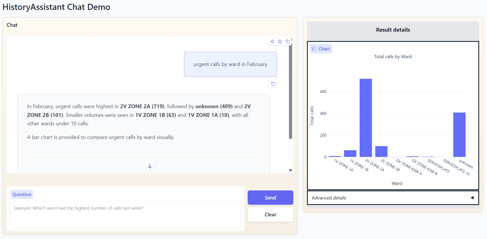
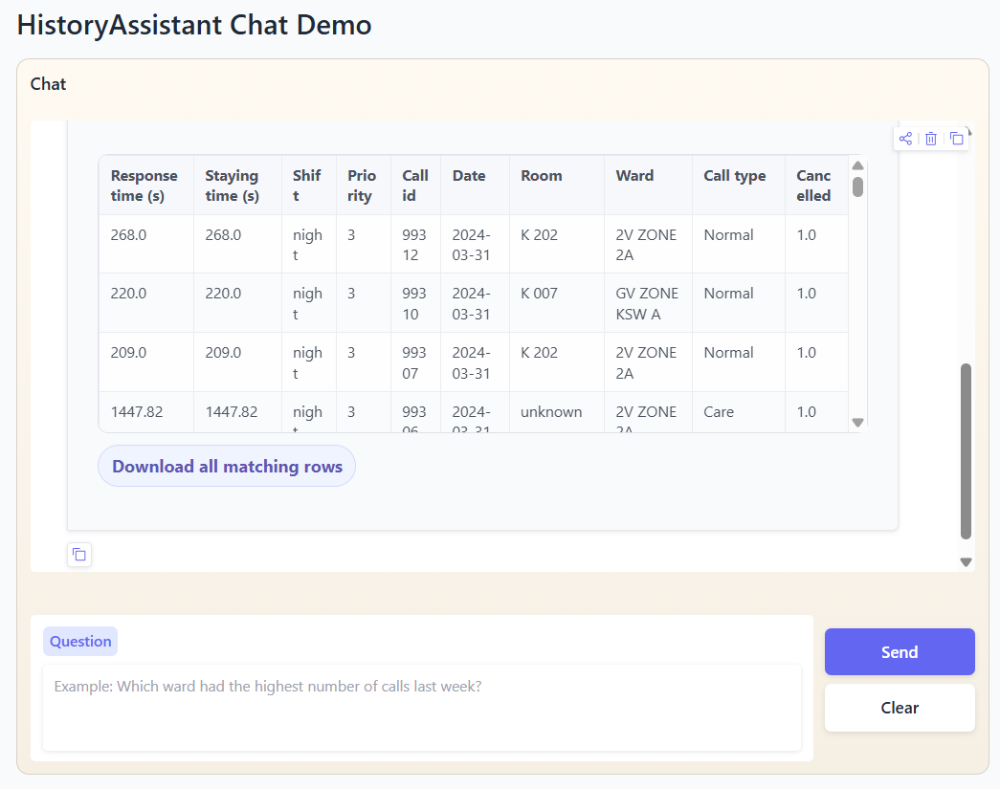

# HistoryAssistant

A natural-language analytics assistant for hospital nurse-call history data. Ask questions in plain English and get answers, tables, and charts — all backed by Elasticsearch.

> 

---

## What it does

Type a question like:
- *"How many calls did ward 2V receive last week?"*
- *"Show me the top 5 wards by average response time this month as a bar chart"*
- *"Which patients were in area 1A on 15 May 2024?"*
- *"Who was present in room K 228 on the night shift last Monday?"*

The system routes the question through a pipeline (classify -> plan -> validate -> execute -> narrate) and returns a text answer, an inline table, a Plotly chart, or a downloadable CSV.

**Three data sources are supported:**

| Source | Table | Description |
|---|---|---|
| `calls` | `historyCalls` | Nurse-call event history (response time, staying time, call counts) |
| `locations` | `historyLocations` | Staff/patient location tracking (movement, last-known location) |
| `workflows` | `historyWorkflows` | Staff workflow presence events (presence counts, room patterns) |

---

## Prerequisites

| Requirement | Version | Notes |
|---|---|---|
| Python | 3.11 | |
| Elasticsearch | 9.x | Must be running locally on port 9200 |
| Azure OpenAI | — | API key + deployment required |
| HuggingFace token | — | For sentence-transformers embeddings (guardrails) |

---

## Setup

### 1. Clone and install dependencies

```bash
git clone <repo-url>
cd HistoryAssistant
pip install -r requirements.txt
pip install gradio elasticsearch openai sentence-transformers
```

### 2. Create a `.env` file in the repo root

```env
OPENAI_API_KEY=your_azure_openai_key
OPENAI_DEPLOYMENT=your_deployment_name
OPEN_BASE_URL=https://your-resource.openai.azure.com/
OPENAI_API_VERSION=2025-04-01-preview
HF_TOKEN=your_huggingface_token
```

### 3. Start Elasticsearch

Elasticsearch must be running at `localhost:9200` before launching the app.

```bash
# If using the Elasticsearch zip/tar distribution:
./bin/elasticsearch

# Verify it is running:
curl http://localhost:9200
```

### 4. Load data into Elasticsearch

Each data source has its own loader script. Run the ones matching the data you have:

```bash
# Nurse-call records
python src/historyAssistant/config/dump_csv_to_elasticsearch_call.py

# Location tracking data
python src/historyAssistant/config/dump_csv_to_elasticsearch_location.py

# Workflow / presence data
python src/historyAssistant/config/dump_csv_to_elasticsearch_workflow.py
```

The data CSV files are expected at the paths defined in `configs/shared/app_config.yaml`:

```yaml
data_sources:
  calls:
    data_path: data/historyCalls/03_processed/fact_history_calls_v3.csv
  locations:
    data_path: data/historyLocations/processed/fact_history_locations_v1.csv
  workflows:
    data_path: data/historyWorkflows/processed/fact_history_workflows_v1.csv
```

---

## Running the app

```bash
python src/run_gradio.py
```

Opens at **http://127.0.0.1:7861**

---

## Using the UI

### Chat panel

Type your question in the text box and press **Send** (or Enter).

- **Date range pickers** — set a date window; the app injects this automatically when your question has no date
- **Time range pickers** — optionally restrict to a time-of-day window
- **Export mode** — choose `No export`, `Export answers` (JSON), or `Export table` (CSV); a download link appears in chat when active
- **Show debug** — toggle to see the full pipeline trace (source routing, plan, execution) on the right panel
- **Clear** — resets the conversation

> 

> 

### Result panel (right side)

- **Chart** — appears automatically when you ask for a chart (e.g. "as a bar chart")
- **Table** — appears for raw record lookups; aggregation results show in the table for non-chart queries
- **Pipeline details accordion** — expandable; shows three stages:
  1. Source Routing — which data source was selected and confidence
  2. Planner — the canonical plan that was built
  3. Execute — the Elasticsearch query and raw results

### Clarification prompts

When a question is ambiguous (e.g. ranking vs flat breakdown), the assistant will ask a follow-up question. Reply with your choice (e.g. "A" or "ranked") to continue.

---

## Example questions to test

### Nurse-call records (historyCalls)
```
How many calls were there last week?
What is the average response time per ward last month?
Show me the top 3 wards by call count this month as a bar chart
Which ward had the longest average staying time in June 2024?
Show me the Panic calls from ward 2V last Monday
How many cancelled calls were there in the night shift last week?
What is the median response time by shift for the last 7 days?
```

### Location tracking (historyLocations)
```
Where was patient [hashed-id] last seen?
Which patients moved through area 1A yesterday?
Show me all location updates for ward 2V on 20 May 2024
How many movement events happened per area last week?
```

### Workflow / presence (historyWorkflows)
```
Who was present in room K 228 last Monday?
How many presence events were there per ward last week?
Show me the night shift presence events from this month
Which nurse had the most presence activations last week?
```

---

## Debug a single question

Run a question directly from the command line and see the full pipeline output:

```bash
python eval/debug_single_question.py "how many calls last week"
```

This prints the canonical plan, validation result, execution result, and timing — useful for diagnosing wrong answers without going through the UI.

---

## Evaluation

Run the evaluation suites against the ground-truth dataset:

```bash
# Full pipeline evaluation against gold_baseline_filled.csv
python eval/eval_gold_baseline.py

# Compare results across multiple runs
python eval/eval_compare_dashboard.py
```

Outputs go to `eval/outputs/`:
- `results.json` — per-question pass/fail with details
- `summary.json` — aggregate accuracy metrics
- `dashboard.png` — visual breakdown chart

> **📸 Screenshot needed:** Add a sample eval dashboard image here (`docs/screenshot_eval_dashboard.png`)

---

## Configuration

Most semantic behaviour is controlled by YAML files in `configs/`. Metrics, dimensions, source routing vocabulary, chart rules, date rules, schema fields, and runtime settings live there. Result narration uses table schema plus a validated LLM field selector for non-raw results; raw-record table answers stay deterministic.

```
configs/
├── shared/
│   ├── app_config.yaml       ← ES connection, row limits, narration mode
│   └── date_rules.yaml       ← Supported date windows (last_week, last_month, etc.)
├── calls/
│   ├── metric_catalog.yaml   ← Metric definitions (aggregation type, field, thresholds)
│   ├── table_registry.yaml   ← Dimensions, filters, source fields, semantic fields
│   ├── vocabulary.yaml       ← Synonyms + slot-planner inference rules
│   ├── chart_catalog.yaml    ← Allowed chart types per metric
│   └── unsupported_topic.yaml← Guardrail blocked topics
├── locations/                ← Same structure as calls/
└── workflows/                ← Same structure as calls/
```

### Key settings in `app_config.yaml`

```yaml
runtime:
  max_result_rows: 70       # Max rows returned in a single query
  default_limit: 10         # Default top-N limit for ranking questions
  narration_mode: "hybrid"  # "hybrid" | "deterministic" | "llm"
```

**`narration_mode` options:**
- `hybrid` — uses compact LLM narration for aggregated results when useful; raw-record answers use deterministic table-first narration
- `deterministic` — always uses template-based text, no LLM calls for narration
- `llm` — uses full LLM narration with the complete result payload for non-raw results

Raw-record result formatting intentionally avoids an extra narration LLM call. The validator also ensures raw-record source fields include the selected table's configured date/timestamp fields, so table answers can show time columns when records are fetched.

### Adding synonyms

Open `configs/<source>/vocabulary.yaml` and add entries under `synonyms:`. No restart needed if the runtime cache is cleared (restart the app).

### Changing schema or field meaning

Open `configs/<source>/table_registry.yaml` to add dimensions, identifiers, timestamp fields, measure fields, `default_source_fields`, or `semantic_fields`. Avoid adding wording-specific field aliases for narration; the narration field selector chooses from the validated result columns and table schema instead.

---

## Project structure

```
src/historyAssistant/
├── agents/        ← Entry-point agents: classification (guardrails → routing) and execution
├── app/           ← Orchestration, UI, narration, clarification, export, and conversation handling
├── planning/
│   ├── core/          ← Canonical plan schema and validator
│   ├── classification/ ← Guardrails and source routing (calls / locations / workflows)
│   ├── extraction/    ← Shared extractors: filters, dates, ranking signals, vocabulary
│   └── intent_planner/ ← Slot planner: intent extraction → slot filling → canonical plan
├── execution/
│   ├── query_builder/ ← Compiles canonical plan → Elasticsearch query body
│   ├── executor/      ← Runs queries, handles comparison periods and full record exports
│   ├── strategies/    ← One file per aggregation family (count, avg, raw_records, time_bucket, …)
│   ├── result/        ← Result formatting, raw-record answers, narration payloads, field selection
│   └── chart/         ← Plotly figure generation
├── llm/           ← LLM client wrapper and all system prompt strings
└── config/        ← Config loader, dimension loader, and data-to-ES loader scripts
```

---

## Troubleshooting


**"No matching results found" for a valid question**
→ Verify the data was loaded correctly into the right ES index. Run `python eval/debug_single_question.py "your question"` to see the generated ES query.

**Wrong source selected (calls vs locations vs workflows)**
→ Check `configs/<source>/vocabulary.yaml` synonym entries. Add a synonym mapping for the term that triggered wrong routing.

**A raw-record answer is slow**
→ Check debug timings. Execution should usually be fast; latency is usually from source-routing or slot-planning LLM calls. Raw-record narration itself is deterministic and should not add an extra LLM call.

**A raw-record table is missing time columns**
→ Check the validated canonical plan's `source_fields`. The validator should add the selected table's configured date/timestamp fields for raw-record plans. If it does not, inspect `configs/<source>/table_registry.yaml` date/timestamp fields.


**Clarification loop not ending**
→ The system allows 2 clarification attempts then falls back to a plain rephrasing suggestion. Rephrase your original question more specifically.

---

## Future: switching to Elasticsearch MCP

The [Elasticsearch MCP server](https://github.com/elastic/mcp-server-elasticsearch) lets model query ES directly as a tool call — model receives the question, writes the ES query, runs it, and returns the answer. This would collapse most of the current pipeline.

### What could be removed

| Layer | Reason |
|---|---|
| `planning/core/` — canonical schema + validator | No intermediate plan format needed |
| `planning/intent_planner/` — full slot planner | model generates the ES query directly |
| `planning/extraction/` — filter, temporal, ranking extractors | model handles extraction in-context |
| `execution/query_builder/` — ES query compiler | model writes the query itself |
| `execution/executor/` — orchestrator | MCP tool handles execution |
| `execution/strategies/` — all aggregation strategy classes | Aggregation logic moves into model's query |
| `agents/execution_agent.py` | Replaced by the MCP tool call |
| `app/pipeline_steps.py` — planning stage | No planning stage needed |


### Recommended migration path

Rather than a full switch, a practical middle ground is:

1. **Keep** guardrails + source routing — cheap, deterministic, no LLM cost
2. **Replace** the slot planner + execution layer with a single model + MCP tool call
3. **Keep** export, UI, and follow-up handling unchanged

This removes around 60% of the codebase while keeping the safety layer and the Gradio UI intact. The main trade-off is losing the deterministic query path (which handles ~80% of questions reliably today) in exchange for much simpler code.
